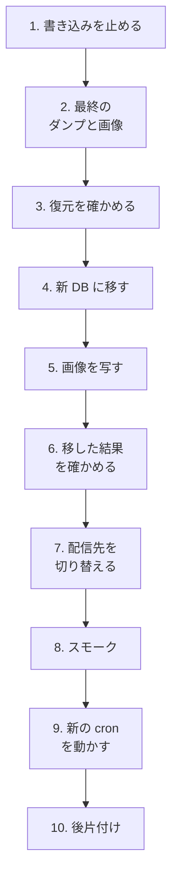

# 切り替えの手順書

本番の旧サイト https://cocktail.trc-vlackhistory.net/ を、新アプリ(このリポジトリ)に切り替える手順と、手順ごとの戻し方(#138)。手順 2〜6 と 8 の curl は、スクリプト(`ops/cutover/`。#139)でまとめて流せる(下の「スクリプトで流す」)。ステージングでの通し稽古は #140 で済ませた(手順 2〜6 が通った。かかった時間などの結果は #140 のコメント)。切り替えた後に旧に戻すときの手順は `docs/rollback.md`(#80)。

- サーバーの配置・デプロイ・Secret は `README.md`、バックアップのスクリプトは `docs/backup.md`、移行の扱いは `docs/migration-anomalies.md` にあり、ここでは繰り返さない
- 接続先・ユーザー名・DB 名・絶対パスはこの文書にも書かない。`<user>`・`<host>`・`<旧アプリの .env>` のようなプレースホルダで書く
- 「未決」と書いたところは、人が決めるまで切り替えを始めない(下の「未決のこと」)。決まったこと(#773 でオーナーが決めた)は、手順に書いてある

## 前提

切り替えの日までに、次がそろっていること。

| 前提 | どこで | 確かめ方 |
|---|---|---|
| 本番の新アプリが `release` から出ていて、`/up`・`/api/hello` が通る | `deploy.yml`(`README.md` の「デプロイ」) | デプロイの Smoke test が緑 |
| 本番の新アプリの `.env` に、新 DB の `DB_*` と旧 DB の `LEGACY_DB_*` がある(新 DB のユーザーは旧 DB を読めるだけ) | #20 | サーバーで `php artisan db:show` と `php artisan db:show --database=legacy` が通る |
| 本番の旧データで、ステージングに移して `legacy:verify` が通った | #36(所要時間も #36 に残っている) | #36 の記録 |
| 旧 URL の 301(カテゴリ・ミドル・旧の管理画面・旧のログイン・SNS カード)が入っている | #78・#58 ほか(`backend/routes/web.php`) | `develop` の E2E が緑 |
| バックアップのスクリプトがサーバーにあり、旧アプリの DB と画像を毎日取っている | `docs/backup.md` | `backup-logs/daily-backup.log` の最後が「終わった」 |
| 復元の確かめに使う、空の DB(例: `<user>_cocktail_verify`)がある | `docs/backup.md` の「サーバーに入れる」の 4 | — |
| 新アプリの scheduler を cron から呼ぶ手順がある | `docs/ops.md` の「定期実行(scheduler)の cron」(#75) | stg で登録して、収集の結果がログに出た(#779) |

## 流れ



- 1〜6 のあいだ、利用者には旧サイトが見え続ける(読むだけ)。7 から新アプリが見える
- 9 までは、旧アプリに戻せば旧サイトがそのまま動く(旧 DB・旧の画像・旧のドキュメントルートには書き込まないため)。9 の後に新アプリで書き込み(管理画面の保存・アフィリエイトの収集)が起きると、旧に戻したときにその分が失われる。戻すかどうかは、9 の前に決める
- issue の並び(移行 → 検証 → 画像)と違い、画像を写してから確かめる。`legacy:verify` が、新 DB の画像の列が指すファイルが新アプリの `storage/app/public` にあるかも見るため(#35)

## スクリプトで流す

手順 2〜6 は `ops/cutover/migrate-data.sh`、8 の curl の確かめは `ops/cutover/smoke.sh` で流せる。1・7・9 は cPanel での作業と人の確かめなので、スクリプトには入れていない。使い方・手順の名前・終了コードは、それぞれのスクリプトの先頭にある。

- どちらも何度流しても同じ結果になる。`migrate-data.sh` は、通った手順を「済み」として残し(既定は `~/cocktail-ops/cutover-state`)、流し直すと済みの手順を飛ばして、落ちた手順から続ける。新 DB のダンプ(4 の 1)は、移す前の 1 回だけ取る
- 途中で失敗したら、その手順で止まり、済みの手順・止まった手順・続け方を出す。直してから同じコマンドを流す
- 6 で失敗して、移行を直したものを出してから 4 から流し直すときは `--from migrate` を付ける。別の日に切り替えをやり直すときは `--restart` を付ける(済みの記録を外して 2 から流す)
- 各手順の出力は、進み具合のディレクトリの `<手順>.log` にも残り、かかった秒数は `<手順>.done` に残る(手元の記録に写す)

`--offsite` は B2 に送らないなら省ける(下の例では付けている)。スクリプトはデプロイでは配られないので、`ops/backup/`・`ops/migrate/`・`ops/cutover/` をそろえて `~/cocktail-ops/` に置く(`migrate-data.sh` は、隣の `backup/`・`migrate/` のスクリプトを呼ぶ)。`php artisan` に版の付いたコマンドを使うときは、環境変数 `PHP` で渡す(`README.md` の「サーバーの PHP の版」)。

```bash
scp -r ops/backup ops/migrate ops/cutover <user>@<host>:~/cocktail-ops/   # 手元のリポジトリから
# 1 の後に、サーバーで
bash ~/cocktail-ops/cutover/migrate-data.sh --old-env <旧アプリの .env> --old-storage <旧の画像のディレクトリ> \
  --verify-db <user>_cocktail_verify --offsite $HOME/cocktail-ops/offsite.conf
# 7 の後に
bash ~/cocktail-ops/cutover/smoke.sh https://cocktail.trc-vlackhistory.net --legacy-category <旧のカテゴリの ID> \
  --expect-count <旧サイトの「現在の登録数」>
```

## 手順と戻し方

コマンドはサーバーに SSH で入って流す。`php artisan` は新アプリのディレクトリ(`~/cocktail-db`)で流す。各手順の出力は、手元の記録(リポジトリの外)に残し、かかった時間も書く(#79 の受け入れ条件)。

### 1. 書き込みを止める

旧アプリで DB と画像を書き換えるのは、管理画面(ログインした管理者の操作)と、毎分のアフィリエイトの収集(旧の `routes/console.php` の scheduler。サーバーの cron から呼ばれている)だけ。両方を止める。

1. 管理画面で編集しない。止め方は取り決めだけにする(管理者は 1 人で、切り替えをするのもその人なので、旧のサーバーは触らない)。注意: うっかり保存すると、3 の復元の確かめでは食い違いとして気づけるが、4 の `legacy:import` は旧 DB をその場で読むので、6〜7 のあいだの保存は新に移らず、気づけない。6 から 7 のあいだも編集しない
2. SSH で `crontab -e` を開き、旧アプリの `schedule:run` の行の先頭に `#` を付けて止める。行は消さない(戻すときは `#` を外す。行を消すのは、切り替えの数週間後の片付け(#81)。`docs/ops.md` の「定期実行(scheduler)の cron」)。止める前に、行の中身を手元の記録に写しておく
3. 2 で止める前に始まっていた旧の収集の回が、すべて終わったことを確かめる。cron の行を止めても、起動済みの回は止まらず、終わるまで旧 DB を書き換えるため(`docs/rollback.md` の 3 の 4 と同じ)。旧は毎分起こし、前の回を待たない(`withoutOverlapping` が無い)ので、1 回とは限らない。旧アプリは、収集の始まりと終わりを自分では記録しない(旧の `routes/console.php` の `Schedule::call` と `AffiliateController::main` はログを書かない)。そのため、何で確かめるかは、1 の 2 で写した行の出力先(`>>` か `>` の後ろ)で決まる
   - 出力先がファイルのとき: そのファイルが記録になる。旧の `schedule:run` は、回ごとに `<日時> Running [Callback]` の行を書き、回が終わると同じ行の後ろに `DONE` か `FAIL` を足す。`tail -n 5 <そのファイル>` で、最後の `Running [Callback]` の行に `DONE` か `FAIL` が付いていることを見る
   - 出力を捨てている(`/dev/null`)とき: 記録が無いので、プロセスの一覧で確かめる。`ps -u "$(id -un)" -o pid,lstart,args` で、旧アプリの `schedule:run` が 1 つも残っていないことを見る。同じアカウントの crontab に stg の `schedule:run`(#779)があれば、それも毎分一覧に出るので、`ls -l /proc/<PID>/cwd` が旧アプリのディレクトリを指すものだけを数える(行がアプリのディレクトリを引数に書いていれば、一覧の `args` でも見分けられる)。一覧に `ps` 自身の行が無いときは、自分のプロセスが見えていないので、この見方は使えない。そのときは、4 で 1 分ではなく 10 分待つ(旧は 1 件ずつ書くが、楽天への問い合わせにタイムアウトを渡しておらず、PHP の `default_socket_timeout`(既定 60 秒)まで待つ問い合わせを 1 件で 2 回しうるので、書き込みの間が数分空くことがある)
   - 残っている回は、終わるまで待つ。`kill` しない(旧は、古くなった行を取り直すとき、古い行を消してから新しい行を書く。その間で止めると、その行が旧 DB から消えたままになる)
4. 3 を確かめてから 1 分待ち、旧 DB の `affiliates` の更新日時がそれより後に増えていないことを見る

- 失敗したとき(cron が見つからない・止まらない・3 の回が終わらない): 2 に進まない。cron の行を探し直す。回が終わらないときは、`kill` せずに待つ
- 戻し方: 2 で付けた旧の cron の行の `#` を外し、管理画面の利用を戻す

### 2. 最終のダンプと画像を取る

`docs/backup.md` の手で流す手順(「サーバーに入れる」の 3)と同じく、旧アプリの `.env` で `daily-backup.sh` を流す。画像が旧アプリの `.env` のあるディレクトリの `storage/app/public` に無いときは、cron と同じく `--storage-dir` を付ける。B2 にも写しを送る(`--offsite`。`docs/backup.md` の「B2 に送る」が済んでいれば)。

```bash
bash ~/cocktail-ops/backup/daily-backup.sh <旧アプリの .env> [--storage-dir <旧の画像のディレクトリ>] \
  --offsite $HOME/cocktail-ops/offsite.conf
ls -l <ホームの絶対パス>/backups/db <ホームの絶対パス>/backups/storage   # 今の時刻の組が 1 つ増えている
```

- `storage/` の `.check.tsv` の `missing`(DB にあってファイルが無い)の件数を記録する。旧データに前からある欠けは 0 にならないことがある(`archive-storage.sh` の先頭)。6 の `legacy:verify` で同じ件数が出るかを見比べる
- 失敗したとき(終了コード 1・2): 3 に進まない。ログの理由を直して流し直す。終了コード 3(B2 に送れなかった)は、サーバーの組は取れているので進めてよい。送り直しは後で `offsite-upload.sh` を手で流す
- 戻し方: 無し(旧 DB・旧の画像は読むだけ)。切り替えをやめるなら 1 の戻し方をする

### 3. 復元を確かめる

2 のダンプを空の DB に戻し、旧 DB と同じかを確かめる(`verify-restore.sh`。#16)。書き込みを止めているので、一致するはず。

```bash
bash ~/cocktail-ops/backup/verify-restore.sh <旧アプリの .env> \
  <ホームの絶対パス>/backups/db/<DB名>-<日時>.sql.gz <user>_cocktail_verify
```

`daily-backup.sh` に `--verify-restore <user>_cocktail_verify` を付けて 2 と一緒に流してもよい(`docs/backup.md` の月 1 回の確かめと同じ形)。

- 失敗したとき(終了コード 2): ログの「- が元、+ が復元」の行を見る。行数が違うなら、1 の書き込みが止まっていない。1 に戻って止めてから、2 から流し直す
- 戻し方: 無し(戻した先は、終わると `verify-restore.sh` が空に戻す)

### 4. 新 DB に移す

1. 本番の新 DB の今の中身を取っておく。`legacy:import` は、旧に無い行を消して旧に合わせる部分がある(アフィリエイトなど)ので、切り替えの前に新アプリで入れたもの(管理画面の設定・パスキーなど)があれば消えうる。戻すときに使う。新アプリの `.env` に `BACKUP_DIR` が無ければ、`docs/backup.md` の「サーバーに入れる」の 2 と同じく足し、`php artisan optimize` で設定を読み直す

   ```bash
   bash ~/cocktail-ops/backup/dump-db.sh ~/cocktail-db/.env
   ```

2. 表を最新にしてから移す(`deploy.yml` も `migrate --force` を流しているので、ふだんは何も起きない)

   ```bash
   cd ~/cocktail-db
   php artisan migrate --force
   php artisan legacy:import
   ```

   `legacy:import` は、部分(`misc`・`categories`・`brands`・`affiliates`・`cocktails`・`descriptions`)ごとに移した件数を出す。人が見て扱いを決める旧の行(`docs/migration-anomalies.md`)が出たら記録する。`ミドルの下へ移した銘柄` は 1(#752。旧で直されていれば 0)

- 失敗したとき: `legacy:import` は、同じ旧データで何度流しても結果が変わらないように書いてある(`LegacyImporter`)。原因を直して、もう一度 `php artisan legacy:import` を流す(落ちた部分だけなら `--only=<部分>`。後ろの部分は前の部分を指すので、落ちた部分から後ろを順に流す)
- 戻し方: 新アプリはまだ利用者に見えていないので、新 DB はそのままでよい。切り替えをやめて、新 DB を 1 の前に戻したいときは、1 で取ったダンプを入れる(`gunzip -c <新 DB のダンプ>.sql.gz | mariadb <新 DB>`。ダンプは `CREATE DATABASE`・`USE` を含まない)

### 5. 画像を写す

旧アプリの画像を、新アプリの `storage/app/public` に写す(`copy-storage.sh`。#34)。旧の画像のディレクトリは、旧のドキュメントルートの `storage` のリンク先(`docs/backup.md` の「サーバーに入れる」の 2)。スクリプトはデプロイでは配られないので、`ops/migrate/` を `ops/backup/` と同じく `~/cocktail-ops/` に置いてから流す。

```bash
scp -r ops/migrate <user>@<host>:~/cocktail-ops/   # 手元のリポジトリから
bash ~/cocktail-ops/migrate/copy-storage.sh --dry-run <旧の画像のディレクトリ> ~/cocktail-db/storage/app/public
bash ~/cocktail-ops/migrate/copy-storage.sh <旧の画像のディレクトリ> ~/cocktail-db/storage/app/public
```

- 終了コード 2(中身の違う同じ名前のファイル)のときは、出た一覧のファイルを旧と新で見比べ、どちらを残すかを人が決める(スクリプトは上書きしない)
- 失敗したとき(終了コード 1): 理由を直して流し直す。写し終えたファイルは飛ばされる
- 戻し方: 旧の画像は変えない・消さないので、戻すものは無い。新の側に写したファイルは、新アプリをやめるなら残っていても害は無い

### 6. 移した結果を確かめる

```bash
cd ~/cocktail-db
php artisan legacy:verify          # 件数・ID の対応・材料・tree:verify・data:verify・画像のファイル(#35)
php artisan legacy:verify-images   # 旧 DB の画像の列が指すファイルが、新の storage/app/public にあるか
```

- `legacy:verify` が通ること(合わないものがあれば一覧を出して失敗する)。`legacy:verify-images` の `missing` が、2 の `.check.tsv` の `missing` と同じ件数であること(旧から欠けていたもの)
- 旧と新の条件検索の突き合わせ(`legacy:compare-search`。#169)も流すなら、デプロイは `tests/` を配らないので、条件の組の JSON(`backend/tests/Fixtures/search-cases.json`)をサーバーに置いて `--cases` で渡す
- 失敗したとき: 7 に進まない。移行の不具合なら issue にして、直したものを `release` から出してから 4 から流し直す。その日に切り替えないなら、1 の戻し方をして旧サイトの書き込みを戻す(新 DB は次の回に 4 から流し直せば旧に合う)
- 戻し方: 無し(読むだけのコマンド)

### 7. ドキュメントルートを切り替える

旧のドメイン(`cocktail.trc-vlackhistory.net`)で、新アプリの `public/` を配信するようにする。旧のドキュメントルート(旧の `index.php` とビルド済みの画面)は消さずに残す(戻すため)。

1. cPanel の「ドメイン」で、`cocktail.trc-vlackhistory.net` のドキュメントルートを、今の `~/public_html/cocktail_html` から、新アプリの `public`(`~/public_html/cocktail-db/public`。`cocktail-next` と同じ形)に変える。旧のディレクトリには触らない。SSH の `uapi` の `SubDomain changedocroot` でも変えられる(#80 で stg で確かめた。使い方は `docs/rollback.md` の 1)。変えてから配信が変わるまで 30 秒ほどかかる
2. 新アプリの `.env` の `APP_URL` を旧サイトの URL にし(末尾の `/` を付けずに https://cocktail.trc-vlackhistory.net とする)、`php artisan optimize` で設定を読み直す。`APP_URL` は、ログインの URL(`admin:login-link`)・パスキー(`docs/decisions/passkey.md`)・OGP・sitemap・画像の URL に使う
3. GitHub の Variable `APP_URL`(`deploy.yml` の Smoke test が叩く)も同じ値にする
4. Web の PHP の版は、ドキュメントルートから上へたどった `.htaccess` で決まる(`README.md` の「サーバーの PHP の版」)。切り替えた先で 8.5 になっているかを、`README.md` の同じ節の確かめ方で見る

- 失敗したとき(500・旧の画面が出る): 下の戻し方で旧に戻し、原因を調べる
- 戻し方: ドキュメントルートを `~/public_html/cocktail_html` に戻す(設定を戻すだけ。旧に戻す手順の全体は `docs/rollback.md`)。`APP_URL`(`.env` と Variable)を前の値に戻して `php artisan optimize`。9 の前なら、1 の戻し方(旧の cron の `#` を外す・管理画面の利用)で旧サイトが元どおりに動く

### 8. スモーク

本番の URL に向けて確かめる。E2E(`e2e/`)の全体は、`E2eSeeder` のデータと、管理画面で行を作って消す操作を前提にしているので、本番には向けない。当面は、次の curl と画面を手で確かめる。本番に向けてよい E2E の組を作るかは #79 で決める。

```bash
APP=https://cocktail.trc-vlackhistory.net
curl -fsS "$APP/up" >/dev/null && curl -fsS "$APP/api/hello"         # deploy.yml の Smoke test と同じ
curl -si "$APP/detail/category/<旧のカテゴリの ID>" | head -5          # 301 で /category/<新の ID> へ(#78)
curl -si "$APP/Cocktail/admin" | head -5                              # 301 で /admin へ(#78)
curl -si "$APP/api/cocktails/count"                                   # 件数が旧サイトの「現在の登録数」と同じ
```

- 画面: トップ・カクテルの詳細(画像のあるもの)・カテゴリの詳細・銘柄の詳細・用語辞典・条件検索・名前の検索が出る。開発者ツールのコンソールにエラーが無い・4xx・5xx の通信が無い
- 管理画面: `php artisan admin:login-link` で出した URL でログインできる(パスキーはドメインに結び付くので、`cocktail-next` で登録したものは使えない。ログインしてから登録し直す。`docs/decisions/passkey.md`)。ここでは保存しない(9 の前に新アプリへ書き込まない)
- `~/cocktail-db/storage/logs/laravel.log` に新しいエラーが無い
- 失敗したとき・戻し方: 直せないものがあれば、7 の戻し方で旧に戻す。旧に戻す基準は、次のどれかが起きたとき: 画面が出ない・件数が旧と違う・500 が出る。切り替えの日時は、切り替えをすると決めたときに書く(下の「未決のこと」の 1)

### 9. 新の cron を動かす

ここから新アプリが書き込む。旧に戻すと、ここからの書き込みは失われる。

1. 新アプリの scheduler(`affiliates:collect --refresh --new`。`backend/routes/console.php`)を cron から呼ぶ。本番でいつ登録するかは `docs/ops.md` の「定期実行(scheduler)の cron」の「どの環境に登録するか」、登録と確かめ方は同じ節の「登録する」「確かめる」(#75)。旧の cron(1 で止め、1 の 3 で収集が終わったことを確かめた)と同時に動かさない(同じアフィリエイトを 2 つが書かないように。#75)
2. バックアップの cron(`docs/backup.md` の「サーバーに入れる」の 5)を、新アプリに向け直す。2 行とも `daily-backup.sh` に渡す `.env` を新アプリの `.env` にし、旧のために付けていた `--storage-dir` を外す(新アプリの画像は `.env` のあるディレクトリの `storage/app/public` にある)。`--verify-restore` の DB を新アプリの DB ユーザーで使えるよう、cPanel で権限を付ける
3. 次の日に、`backup-logs/daily-backup.log` の最後が「終わった」で、新 DB のダンプ(`<新 DB 名>-<日時>.sql.gz`)ができていることを確かめる。アフィリエイトの収集の結果が `storage/logs/laravel.log` に出ていることも見る

- 失敗したとき: cron の行を消して止め、原因を直す。新アプリの表示は cron が無くても動く
- 戻し方: 新の cron の行を消す。旧に戻すなら、`docs/rollback.md` の順(配信先 → `APP_URL` → 新の cron → 新に入った変更の洗い出し → 旧の cron と管理画面)で流す。洗い出す前に旧の cron と管理画面を戻さない(旧 DB が書き換わり、新で入ったものを見分けられなくなる)。バックアップの cron も旧に向け直す。ここまでに新アプリで書いたもの(管理画面の保存・アフィリエイト)は旧 DB に入らない

### 10. 後片付け

- 旧のドキュメントルート・旧アプリ・旧 DB は消さない。消す時期は今は決めず、切り替えの後に別の issue で決める
- 1 で止めた(先頭に `#` を付けた)旧の cron の行も、ここでは消さない。消すのは、切り替えの数週間後の片付け(#81。`docs/ops.md` の「定期実行(scheduler)の cron」)
- 切り替えた後の `cocktail-next.trc-vlackhistory.net` は、旧のドメインへ 301 で転送する(残すと同じ中身が 2 つのドメインに出る。消すと共有したリンクが開けなくなる)
- `README.md` の「公開先」・Variable `APP_URL` の値・「サーバー上の配置」を、切り替えた後の形に直す(別の PR)
- 手元の記録(各手順の出力・かかった時間)のうち、公開してよいもの(件数・時間)を #79 に残す。ホスト名・ユーザー名・DB 名・絶対パスは書かない

## 未決のこと

人が決めるまで、切り替えを始めない。決まったら、この節から外して上の手順に書く。

1. **切り替えの日時**。書き込みを止めるあいだ(1〜9)は管理画面で編集できない。切り替えをすると決めたときに、#36 の所要時間を見て、編集を止めてよい時間帯を決めて書く(戻す基準は 8 に書いた)

決まったこと(#773)

- 旧の管理画面の止め方は、取り決めだけ(1)
- ドキュメントルートの切り替えは、cPanel の「ドメイン」で変える(7)
- 本番のスモークは、当面は手の確かめ。E2E の組は #79 で決める(8)
- 旧を消す時期は、切り替えの後に別の issue で決める(10)
