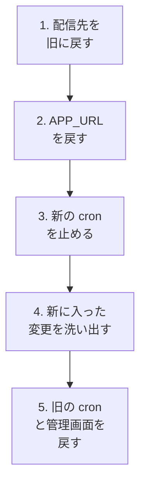

# 旧に戻す手順書

本番を新アプリに切り替えた後に、旧サイト https://cocktail.trc-vlackhistory.net/ を旧アプリに戻す手順(#80)。切り替えの手順書(`docs/cutover.md`)の手順ごとの「戻し方」を、戻すときに流す順にまとめた。

- 旧 DB・旧の画像・旧のドキュメントルート(旧の `index.php` とビルド済みの画面)は、切り替えで書き換えも削除もしない(`docs/cutover.md` の「流れ」)。そのため、旧に戻すのは設定を戻すだけで済み、旧サイトは切り替えの前の中身でそのまま動く
- 接続先・ユーザー名・DB 名・絶対パスはこの文書にも書かない。`<user>`・`<host>` のようなプレースホルダで書く

## いつ戻すか

- 戻す基準は、切り替えの手順書の 8 のとおり。次のどれかが起きて、その場で直せないとき: 画面が出ない・件数が旧と違う・500 が出る
- 切り替えの手順 9(新の cron を動かす)の前か後かで、戻したときに失うものが変わる
  - 9 の前: 新アプリはまだ何も書いていないので、失うものは無い。下の 1・2・5 を流す
  - 9 の後: 新アプリで書いたもの(管理画面の保存・アフィリエイトの収集)は旧 DB に入っていない。戻すと旧サイトからは見えなくなる。下の 1〜5 を順に流し、「切り替えの後に新に入った変更」で扱いを決める

## 流れ



- 1 から、利用者には旧サイトが見える。2〜5 は利用者から見えない
- 3〜5 は、切り替えの手順 9 の後に戻すときだけ流す(9 の前なら 3・4 は飛ばし、5 は旧の cron と管理画面を戻すだけ)
- 4 は 5 より先に流す。5 で旧の cron と管理画面を戻すと旧 DB が書き換わり始め、旧と新の食い違いのどれが新で入ったものかを見分けられなくなる

## 1. 配信先を旧に戻す

旧のドメイン(`cocktail.trc-vlackhistory.net`)のドキュメントルートを、新アプリの `public`(`~/public_html/cocktail-db/public`)から、旧の `~/public_html/cocktail_html` に戻す。新アプリのディレクトリには触らない(もう一度切り替えるときに使う)。

ドメインのドキュメントルートの設定を変える(切り替えと同じく、旧のディレクトリには触らない。#773)。SSH からでも、cPanel の画面からでも変えられる。

- SSH: `uapi` の `SubDomain changedocroot` で、ドメインはサブドメインの名前そのまま、ドキュメントルートはホームからの相対で渡す(先頭に `/` を付けると断られる)。stg で確かめた(下の「stg での練習」)

  ```bash
  uapi SubDomain changedocroot domain=cocktail.trc-vlackhistory.net docroot=public_html/cocktail_html
  uapi DomainInfo domains_data   # 変わったのが cocktail.trc-vlackhistory.net の documentroot だけか
  ```

- 画面: cPanel の「ドメイン」で、`cocktail.trc-vlackhistory.net` のドキュメントルートを `public_html/cocktail_html` に変える

- 確かめる: 30 秒ほどで旧の画面に変わる(stg の練習では、変え始めてから 26〜28 秒)。旧の画面かどうかは、トップの HTML で見分ける(旧は Vue の `id="app"`、新は React の `id="root"` と `/spa/` の読み込み)。ブラウザはキャッシュで前の画面を出すことがあるので、curl で見る

  ```bash
  curl -s https://cocktail.trc-vlackhistory.net/ | grep -c 'id="app"'   # 1 なら旧
  ```

- 失敗したとき(旧の画面にならない・500): ドキュメントルートの値を `uapi DomainInfo domains_data` で見て、`public_html/cocktail_html` になっているかを確かめる。値が合っていて画面が出ないなら、旧のドキュメントルートの中身が切り替えの前から変わっていないか(消していないか)を見る

## 2. APP_URL を戻す

切り替えの手順 7 の 2・3 で旧サイトの URL にした `APP_URL` を、前の値に戻す。前の値は、新アプリが切り替えの前に動いていた `cocktail-next` の URL で、末尾の `/` を付けずに https://cocktail-next.trc-vlackhistory.net とする。新アプリは `cocktail-next` で動き続け、`APP_URL` をログインの URL・パスキー・OGP・sitemap・画像の URL に使うため。

1. 新アプリの `.env` の `APP_URL` を前の値にし、`php artisan optimize` で設定を読み直す
2. GitHub の Variable `APP_URL`(`deploy.yml` の Smoke test が叩く)も同じ値にする
3. 切り替えの手順 10 で `cocktail-next.trc-vlackhistory.net` を旧のドメインへ 301 で転送していたら、その転送を外す

## 3. 新の cron を止める

切り替えの手順 9 の後だけ。新アプリの `schedule:run` と旧アプリの `schedule:run` を同時に動かさない(同じアフィリエイトを 2 つのアプリが集めないように。`docs/ops.md` の「定期実行(scheduler)の cron」)ので、旧の cron を戻す(5)より先に止める。

1. `crontab -e`(か cPanel の「Cron ジョブ」)で、新アプリの `schedule:run` の行を消す
2. バックアップの cron(切り替えの手順 9 の 2 で新アプリに向け直した 2 行)を、旧アプリに向け直す。`daily-backup.sh` に渡す `.env` を旧アプリの `.env` に戻し、旧のための `--storage-dir <旧の画像のディレクトリ>` を付け直す
3. `crontab -l` で、新の `schedule:run` の行が無く、バックアップの 2 行が旧アプリを向いていることを確かめる

## 4. 新に入った変更を洗い出す

切り替えの手順 9 の後だけ。旧 DB は切り替えのあいだ書き換えていないので、旧と新の食い違いが、切り替えの後に新に入った変更にあたる。旧の cron と管理画面を戻す(5)前に流す。

1. 新 DB の今の中身を取っておく。新に入った変更を後から見直すため(捨てると決めたものも、ここに残る)

   ```bash
   bash ~/cocktail-ops/backup/dump-db.sh ~/cocktail-db/.env
   ```

2. 旧と新の食い違いを出す。件数・ID の対応・材料などの食い違いが一覧で出る(切り替えの手順 6 では通っていたので、出たものは切り替えの後に新で変えたもの)

   ```bash
   cd ~/cocktail-db && php artisan legacy:verify
   ```

3. `legacy:verify` で拾えない書き換えもあるので、作成・更新の日時でも探す。切り替えの手順 9 の時刻より後の行を、`cocktails`・`brands`・`categories`・`dictionaries`・`paraphrases`・`skip_words` で探す。日時は UTC で入っている(アプリのタイムゾーンが UTC)。材料(`cocktail_ingredients`)には日時の列が無く、材料だけを変えたときはカクテルの更新日時が動かないことがある。材料の食い違いは 2 で見る

   ```sql
   SELECT id, created_at, updated_at FROM cocktails
    WHERE created_at >= '<手順 9 の時刻(UTC)>' OR updated_at >= '<手順 9 の時刻(UTC)>';
   ```

## 切り替えの後に新に入った変更

| 変更 | 扱い |
|---|---|
| 管理画面の保存(カクテル・銘柄・カテゴリ・用語辞典・言い換え・スキップ語) | 既定は捨てる。残したいものだけ、5 で管理画面を戻した後に、旧の管理画面で手で入れ直す。入れ直したものは、次に切り替えるとき `legacy:import` で旧から新に移る |
| アフィリエイトの収集 | 捨てる。5 で戻す旧の cron が、旧の側で集め直す |
| 新にしか無いもの(設定・パスキー・ログインの URL) | 旧には写す先が無いので、新 DB に残したままにする。次に切り替えるときは、切り替えの手順 4 の 1 で、その時の新 DB をまた取っておく |

- 旧の管理画面で入れ直すときは、4 で出した一覧と、4 の 1 で取った新 DB のダンプを見ながら入れる。新の ID は旧と同じとは限らない(`legacy_id_maps` で対応する)
- 新で消した行は、旧には残っている。消したままにしたいなら、旧の管理画面で消し直す

## 5. 旧の cron と管理画面を戻す

1. 切り替えの手順 1 の 2 で止めた旧アプリの `schedule:run` の行を、`crontab -e`(か cPanel の「Cron ジョブ」)で元に戻す。行を消していたら、手元の記録に写しておいた行を登録し直す。新の `schedule:run` の行が無いこと(3)を確かめてから戻す
2. 1 分待ってから、旧 DB の `affiliates` の更新日時が進んでいることを見る
3. 管理画面の利用を戻す(切り替えの手順 1 の 1 の取り決めを解く)。4 で残すと決めた変更があれば、ここで旧の管理画面で入れ直す

## もう一度切り替えるとき

原因を直したものを `release` から出してから、切り替えの手順書を 1 から流し直す。`migrate-data.sh` は、前の回の「済み」の記録が残っているので、`--restart` を付ける(`docs/cutover.md` の「スクリプトで流す」)。

## stg での練習(2026-11-24)

stg(`cocktail-stg.trc-vlackhistory.net`)で、旧に戻す 1 の操作(ドキュメントルートを変える)と、その戻し(切り替え直し)を 1 回ずつ流した。stg には旧アプリが無いので、旧の代わりに、目印の 1 行だけを書いた HTML を置いたディレクトリを使った。どちらも SSH の `uapi SubDomain changedocroot` で変え、サーバーの上から 1 秒ごとに curl して、配信が変わるまでの秒数を測った。

| 操作 | `uapi` が返るまで | 配信が変わるまで(変え始めから) |
|---|---|---|
| 新アプリ → 目印のページ(旧に戻すのにあたる) | 0.9 秒 | 26.2 秒 |
| 目印のページ → 新アプリ(切り替え直しにあたる) | 1.4 秒 | 27.9 秒 |

- 変える前と後で `uapi DomainInfo domains_data` を突き合わせ、変わったのが stg のドキュメントルートだけ(本番・dev・`cocktail-next` はそのまま)であることを確かめた。練習のあいだ、本番は 200 を返し続けた
- stg の `public` はアプリ本体の `public` へのシンボリックリンクで、Basic 認証と PHP の版は、ドキュメントルートから上へたどった `.htaccess` で決まる(`README.md` の「サーバーの PHP の版」)。戻した後のドキュメントルートの値が、変える前と一字一句同じ(リンクの先に置き換わっていない)こと、`/up` が 401 と `WWW-Authenticate` を返すことを確かめた
- 練習しなかったもの
  - 2(`APP_URL`): `.env` の書き換えと `php artisan optimize` だけで、配信の切り替えとは別に効く。stg の `.env` はデプロイのたびに Secret から作り直されるので、書き換えても練習の後に残らない
  - 3・5(cron): 旧アプリの cron は本番にしか無く、切り替えの前の今は止めていないので、戻す対象が無い。stg の `schedule:run`(#779)を止めると、stg の収集が止まるだけで、旧に戻す練習にはならない
  - 4(洗い出し): `legacy:verify` は、切り替えの通し稽古(#140)の手順 6 で stg でも流して通っている。stg の新 DB には、切り替えの後に管理画面で保存したものに当たる変更が無いので、食い違いが出たときの形は確かめていない
